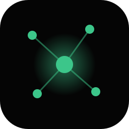

<p align="center">
  
</p>

<h1 align="center">ckb-lifeline</h1>

<p align="center">
  <a href="README.md">English</a> ·
  <a href="README.zh-CN.md">简体中文</a> ·
  <b>Polski</b>
</p>

<p align="center">
  <b>Więcej niż jedno wejście.</b><br>
  Niezależne węzły CKB dla light clientów w przeglądarce, przepis na własny węzeł w jedno popołudnie i test, który pokazuje, co dzieje się bez nich.
</p>

<p align="center">
  <a href="docs/node-recipe.md"><b>Uruchom węzeł</b></a> ·
  <a href="docs/verify.md"><b>Sprawdź</b></a> ·
  <a href="docs/test-protocol.md"><b>Protokół testu</b></a> ·
  <a href="docs/rpc.md"><b>Publiczne RPC</b></a> ·
  <a href="CHANGELOG.md"><b>Zmiany</b></a> ·
  <a href="CONTRIBUTING.md"><b>Współpraca</b></a>
</p>

<p align="center">
  <a href="CHANGELOG.md"></a>
  <a href="LICENSE"></a>
  <a href="https://github.com/nervosnetwork/ckb/releases/tag/v0.210.0"></a>
</p>

<p align="center">
  
</p>

Portfel, który uruchamia light client CKB w przeglądarce, nie może rozmawiać z siecią tak jak pełny węzeł. Strona internetowa otworzy tylko połączenie WebSocket po TLS, i to do nazwy domenowej: `/dns4/<domena>/tcp/443/wss/p2p/<peer id>`. Synchronizację zaczyna dopiero przy dwóch takich peerach.

Dziś każdy opublikowany w tym celu adres, 26 na mainnecie i 12 na testnecie, należy do jednej domeny: `*.ckb.guide`. Aplikacje kopiują tę listę. Jeśli ta jedna domena przestanie odpowiadać, na godzinę albo na stałe, wszystkie te aplikacje jednocześnie tracą sieć.

ckb-lifeline to druga połowa: więcej węzłów, prowadzonych przez więcej osób, do których przeglądarka może się dostać.

- **Przepis na węzeł.** Jedno `docker compose up -d` na małym serwerze: oficjalny obraz CKB, Nginx na porcie 443 (WSS dla przeglądarek, zwykłe P2P dla innych węzłów), certyfikat, który sam się odnawia. [Od pustego serwera](docs/node-recipe.md) w około godzinę.
- **Sprawdzenie prawdziwym klientem.** `lifeline check` uruchamia oficjalny light client w Chromium z Twoim węzłem jako jedynym peerem i mówi, czy portfel mógłby z niego korzystać.
- **Test, który każdy może powtórzyć.** `lifeline test` blokuje `*.ckb.guide` w przeglądarce, i tylko tam, i mierzy, co robi light client z niezależnymi węzłami i bez nich. Każda próba zostaje zapisana w surowej postaci.
- **Lista dla aplikacji.** W `nodes/` są węzły, które przeszły sprawdzenie, do wkompilowania obok zwykłej listy. Nic nie jest pobierane w trakcie działania.
- **Opcjonalne publiczne RPC.** Ten sam węzeł może odpowiadać na JSON-RPC dla metod odczytu i `send_transaction`, [za filtrem i limitami](docs/rpc.md). Wyłączone, dopóki go nie włączysz.

## Co dzieje się dziś

Pomiary z 16 listopada 2026: oficjalny light client (`@nervosnetwork/ckb-light-client-js` 0.5.5) w Chromium, start z 26 adresów mainnetu, które aplikacje mają dziś wbudowane, po 10 prób. Surowe dane: [data/results/2026-11-16-mainnet-eu-1](data/results/2026-11-16-mainnet-eu-1).

| | `*.ckb.guide` | Zsynchronizowany | Peery | Czas do synchronizacji (mediana) |
|---|---|---|---|---|
| **A** | odpowiada | 10 z 10 | 2 po 2,7 s | 10,7 s |
| **B** | nie odpowiada | 0 z 10 | 0 przez całe 300 s | nigdy |

Bez tej jednej domeny light client w przeglądarce nie dostaje ani jednego peera. Test zmieniał wyłącznie resolver samej przeglądarki; poza tym wszystko było tak samo.

Na lokalnym devnecie, gdzie dwa węzły udają zwykłych peerów, a dwa niezależne ([dane](data/results/2026-11-16-devnet-local-devnet)), niezależne węzły przywracają klienta: przelewy wysłane przez niego trafiały do bloku po 9–10 s, a odczytane saldo zgadzało się z pełnym węzłem. Drugiego peera osiągał jednak dopiero po około 60 s, bo pierwsze próby marnuje na adresy, których już nie ma. Pomiary na mainnecie z niezależnymi węzłami i z drugiej lokalizacji dojdą, gdy węzły ruszą.

## Dlaczego to robię

Light client ma być sposobem na korzystanie z sieci bez ufania cudzemu serwerowi. W przeglądarce wciąż zaczyna od czyjejś listy serwerów, a dziś na tej liście jest jedna nazwa.

Nikt nie zrobił tu nic złego. Ktoś musiał uruchomić pierwsze węzły WSS i to zrobił, za darmo. Brakuje drugiego operatora i trzeciego. To koszt małego serwera i jednego popołudnia. Dlatego uruchamiam węzły, spisuję, jak to zrobić, i otwarcie sprawdzam, czy to coś zmienia.

## Jak to działa

| | Bez niezależnych węzłów | Z nimi |
|---|---|---|
| **Lista startowa** | 26 adresów w `*.ckb.guide` | te same 26 i węzły z `nodes/mainnet.json` |
| **`*.ckb.guide` odpowiada** | light client się synchronizuje | synchronizuje się, od większej liczby operatorów |
| **`*.ckb.guide` nie odpowiada** | brak peerów, nic się nie ładuje | synchronizuje się przez niezależne węzły |

Lista trafia do aplikacji przy jej budowaniu. Węzeł z listy nie może nikogo przekierować: light client sam weryfikuje nagłówki i dowody, a węzeł może co najwyżej wstrzymać dane, i właśnie przed tym chroni większa liczba węzłów.

## Pierwsze kroki

### Uruchom węzeł

```bash
git clone https://github.com/PTK030/ckb-lifeline
cd ckb-lifeline
sudo sh node/scripts/setup-vps.sh
cp node/.env.example node/.env     # Twoja domena, mainnet albo testnet
cd node && docker compose up -d
sh scripts/certificate.sh
```

Cały przewodnik, z tym, co sprawdzić po każdym kroku: [docs/node-recipe.md](docs/node-recipe.md).

### Wypróbuj wszystko lokalnie

Wymaga Node.js 22+ (npm 11), Dockera i Chromium dla Playwrighta.

```bash
npm ci && npx playwright install chromium && npm run build
npm run devnet:up                 # cztery węzły lokalnego łańcucha i koparka
npx lifeline test --network devnet --conditions A,B,C,F --trials 2 --seconds 120
npm run devnet:down
```

Devnet używa tego samego entrypointu i tej samej konfiguracji Nginx co serwer; dwa jego węzły udają zwykłych peerów, dwa niezależne. [docs/deploy-mainnet.md](docs/deploy-mainnet.md) to lista kroków przy przejściu na testnet i mainnet.

### Sprawdź węzeł albo przetestuj sieć

```bash
npx lifeline check /dns4/ckb1.example.org/tcp/443/wss/p2p/Qm...
npx lifeline verify --network mainnet        # po jednej próbie B i C, ok. 5 minut
npx lifeline test --network mainnet --conditions A,B --trials 10 --location <gdzie jesteś>
```

Albo bez Node.js: `docker run --rm ghcr.io/ptk030/lifeline-test verify --network mainnet`.

## Niezależne węzły

| Sieć | Adres | Operator |
|---|---|---|
| | *Jeszcze żadnego.* [Uruchom swój](docs/node-recipe.md) i otwórz pull request. | |

## Repozytorium

| Ścieżka | |
|---|---|
| `node/` | Przepis: plik compose, entrypoint CKB, Nginx, filtr RPC, skrypty serwera |
| `devnet/` | Lokalny łańcuch z czterema węzłami |
| `packages/probe` | Light client na stronie w przeglądarce i sterownik, który go uruchamia |
| `packages/cli` | `lifeline`: check, test, verify, uptime |
| `nodes/` | Niezależne węzły dla każdej sieci |
| `data/results/` | Surowe wyniki każdego przebiegu testu |
| `docs/` | Przepis, protokół testu, weryfikacja, development |

[docs/development.md](docs/development.md) opisuje, jak części do siebie pasują i co łatwo zepsuć. Dokumentacja w `docs/` jest po angielsku.

## Licencja

[MIT](LICENSE).
